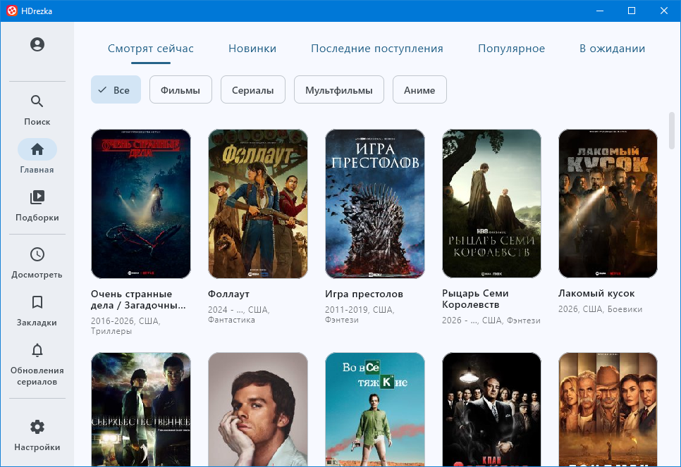
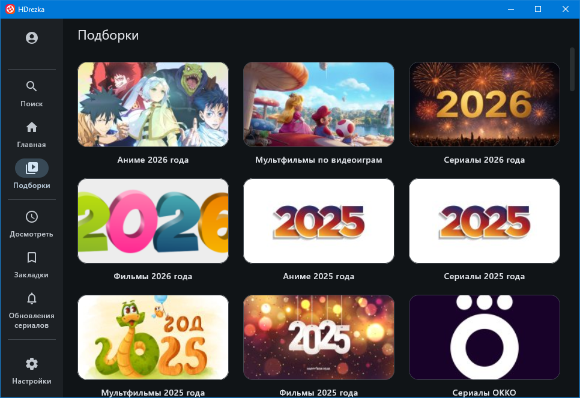
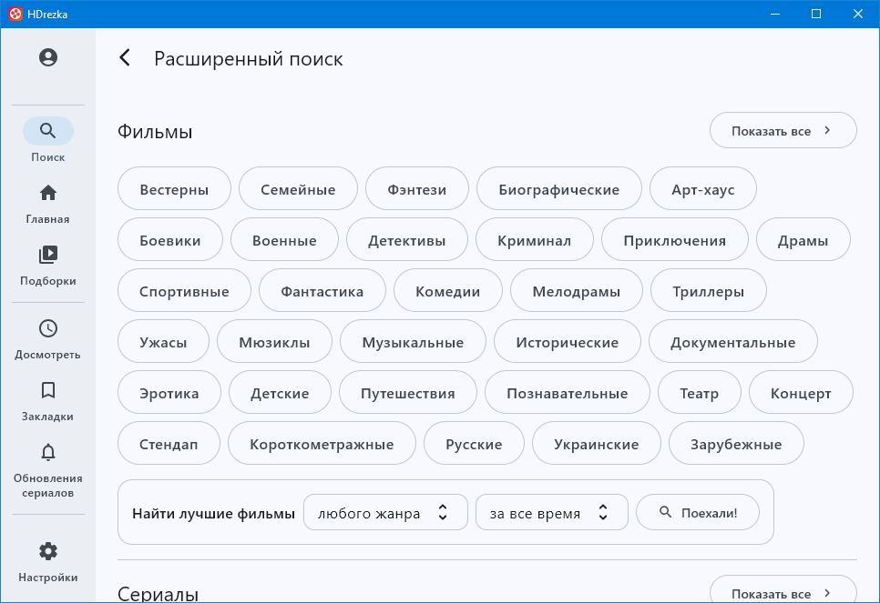
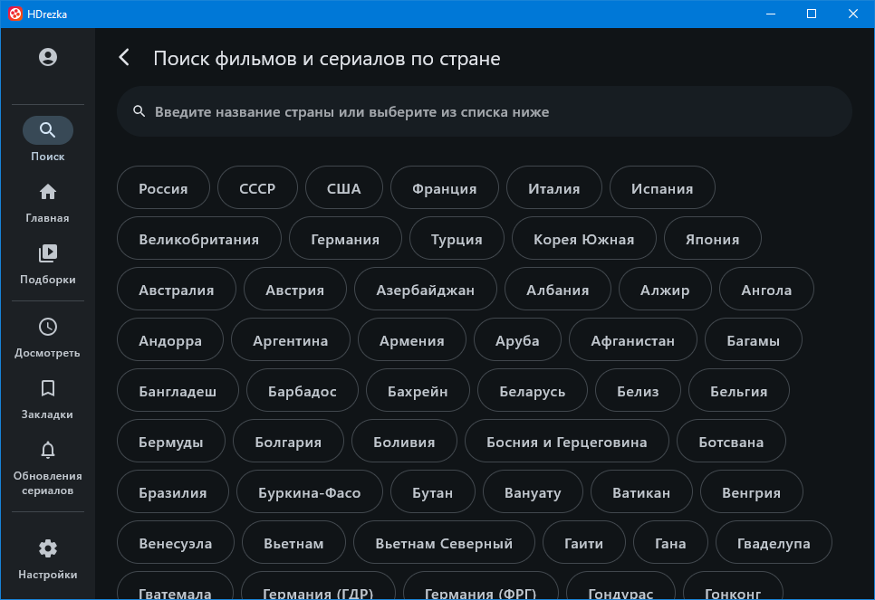
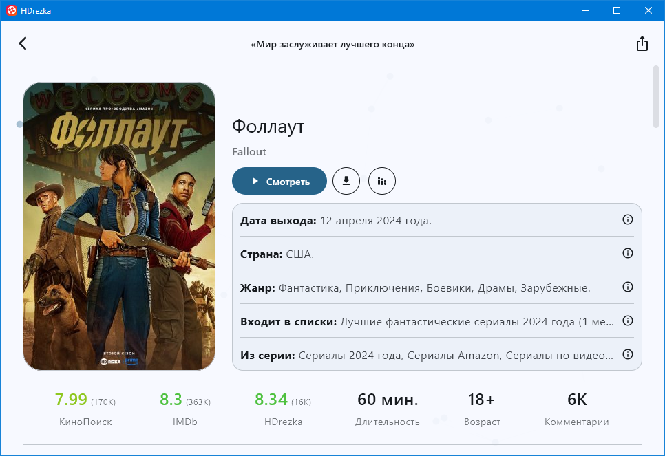
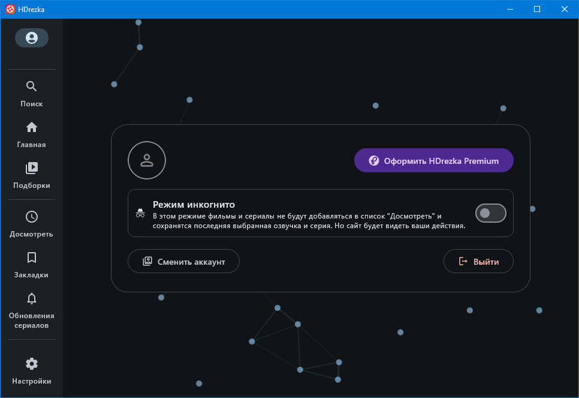
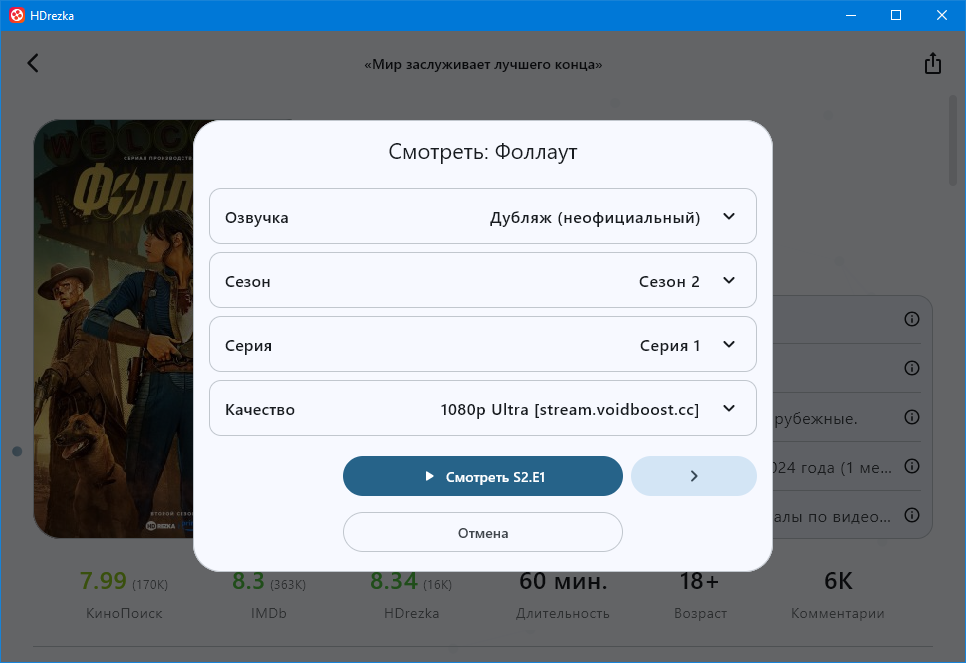
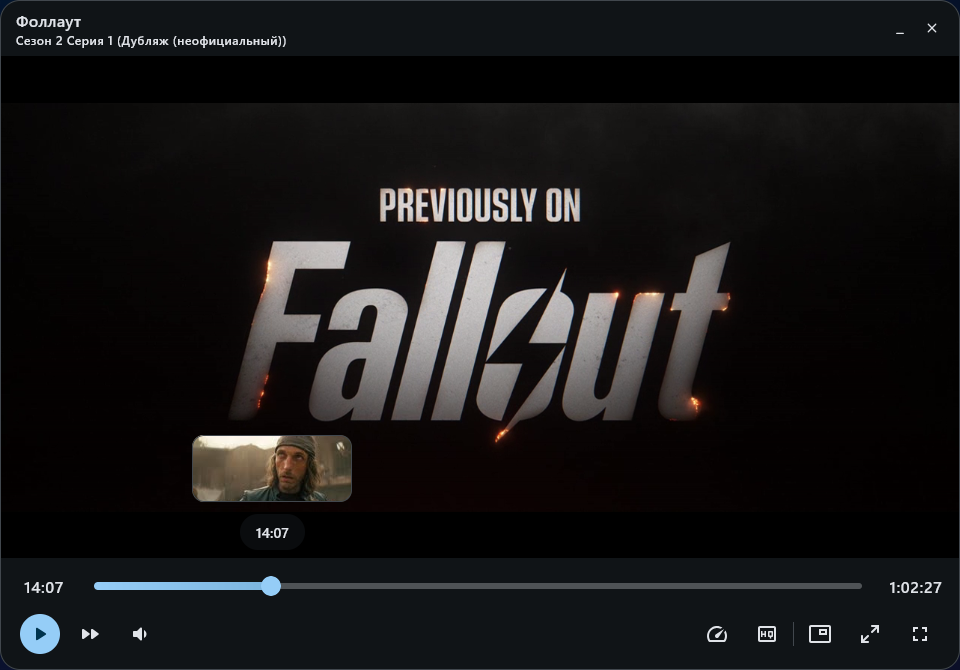
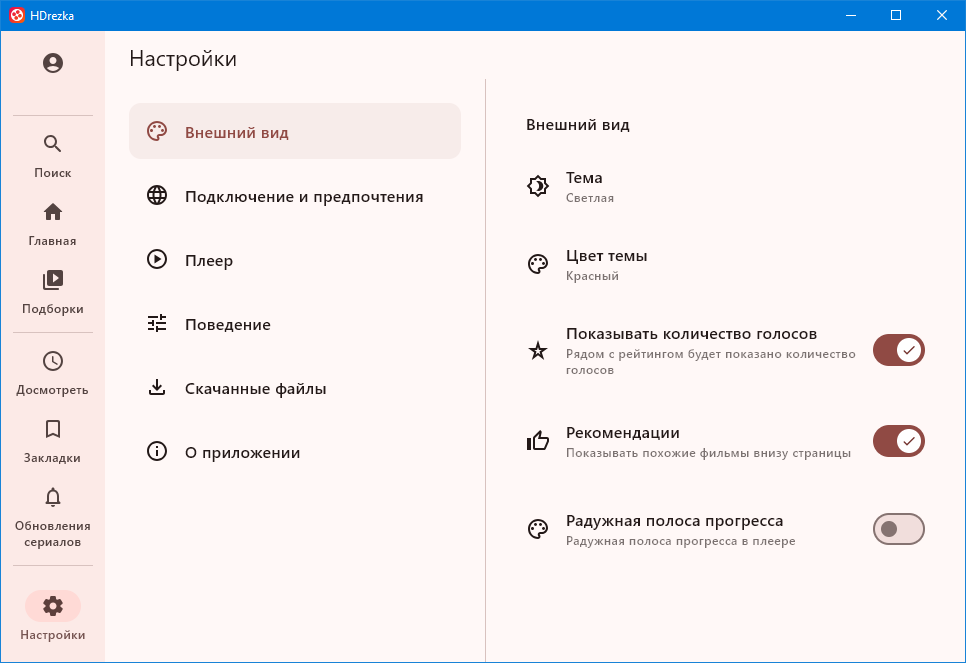
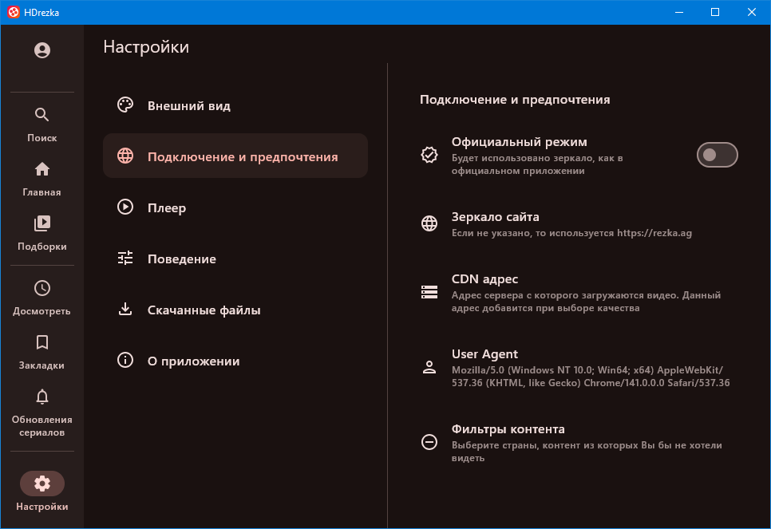

# HDrezka for Desktop (🪟Windows)

Неофициальный клиент HDrezka для Windows и администрация сайта rezka.ag не имеет к нему никакого отношения. Автор не несет ответственности. Используйте на свой страх и риск. [Правила пользования сервисом HDrezka](https://rezka.ag/rules/)

## Функции
* 🪟 Поддержка платформы Windows 10/11 (Возможно и более старых версий, не проверял). Поддержка Linux (в разработке).
* 🎞️ Свой видеоплеер (Требуется VLC media player)
* ▶️ Умная функция продолжить просмотр
* 📽️ Удобный список фильмов, сериалов, мультфильмов и аниме
* 🔍 Поиск (история поиска, поиск по категориям или странам)
* 🔒 Авторизация аккаунта (мультиаккаунт, режим инкогнито)
* 💬 Комментарии
* 🔖 Закладки
* ⬇️ Возможность загрузки видео
* 🌗 Светлая и тёмная темы
* 🌐 Локализация: английский, русский, украинский
* ✨ И многое другое

## Поддержка проекта
Чтобы приложение развивалось и оставалось актуальным, вы можете поддержать донатом.
💲[ЮMoney](https://yoomoney.ru/to/410012772338174)

## Скриншоты
|Светлая|Темная|
|:-----------:|:-----------:|
|||
|||
|||
|||
|||
